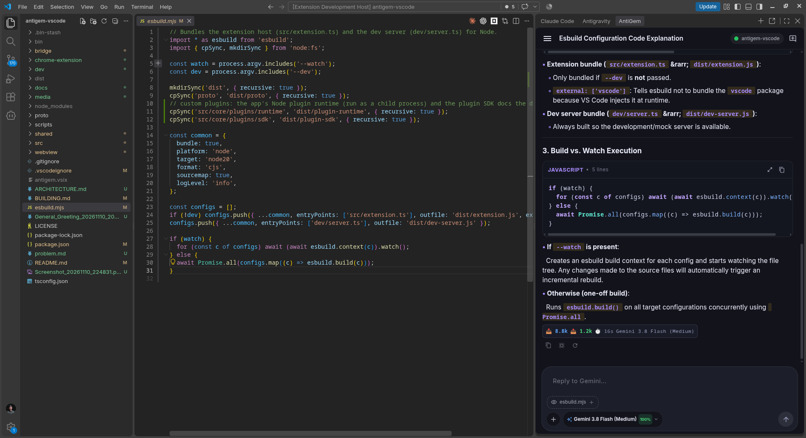
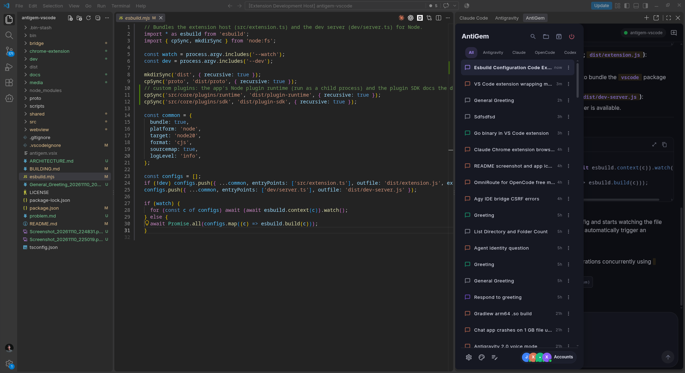
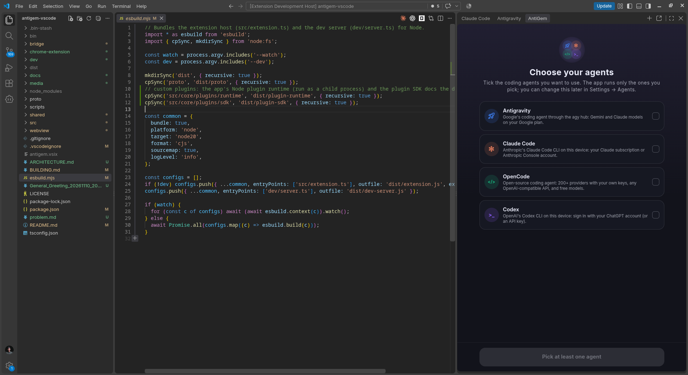

# AntiGem for VS Code

**One chat for all your coding agents.** AntiGem puts **Antigravity (agy)**, **Claude Code**, **Codex** and
**OpenCode** in one sidebar inside VS Code. They share one chat UI, one chat list and one settings screen. You can
use them one at a time or all at once.

It is the VS Code version of the [AntiGem Android app](https://github.com/santoshkurmi/antigem), with the same look,
animations and features, adapted to the editor.

  
  

---

## Supported agents

| Agent | What AntiGem uses | You need |
|---|---|---|
| **Antigravity (agy)** | The Antigravity CLI's hub, the same backend as the Antigravity IDE | `agy`, signed in to your Google account |
| **Claude Code** | The `claude` CLI | `claude`, signed in (Claude subscription or API key), or a custom Anthropic-compatible provider |
| **Codex** | The `codex` CLI (`app-server`) | `codex`, signed in with ChatGPT or an API key |
| **OpenCode** | The `opencode` CLI (`opencode serve`) | `opencode` with at least one provider configured |

You only need the agents you want to use. On first start AntiGem asks which ones to show.

- **Install the CLIs from AntiGem:** each agent's *Account & CLI* page shows the version and sign-in state, and has
  Install / Update buttons that install the vendor's official build.
- **Custom CLI locations:** set them under *Settings → Agents*.
- **Antigravity chat history:** AntiGem shows your **Antigravity IDE** history by default. You can switch to the
  Antigravity app's history, or the agy CLI's, under *Settings → Antigravity → Chat history*.

## Features

### Chat
- **Live replies:** streaming answers, collapsible thinking, and a card for every tool call (commands, file edits with
  diffs, searches, web fetches, MCP calls) with its status, output and duration.
- **Approvals and questions:**
  - Allow once, always, or deny.
  - Answer the agent's multiple-choice questions.
  - Review plans before they run.
- **Rich content:**
  - Markdown with syntax-highlighted code.
  - **LaTeX math** (KaTeX).
  - **Mermaid diagrams**.
  - Tables, images and links.
- **Run code blocks:** ▶ runs a shell block in an *AntiGem* terminal. Long output and diffs open in an editor tab.
- **Edit and retry:** edit an earlier message and continue from there, or regenerate a reply. With Claude Code you
  can also restore the files changed since that message.
- **Queue messages:** send while the agent is still working; your message waits its turn.
- **Per-chat controls:** model, reasoning effort, thinking, permission mode and fast mode, depending on what the
  agent supports.
- **Models with usage limits:** the model picker shows each plan's remaining quota (5-hour and weekly windows) and
  when it resets.
- **Slash commands:** each agent's own commands plus your custom commands. A *global context* can be added to every
  message.
- **Compaction:** when a conversation is compacted, a *Context Memory* card shows the summary at the point where it
  happened.
- **Subagents:**
  - Claude Code subagents and Antigravity subagent chats appear nested under their chat in the sidebar.
  - Open one to read its full run (read-only).
  - Background agents show live status, then their final report.

### Built into VS Code
| What | How |
|---|---|
| Selection → chat | Select code: the composer offers it as a chip (`file.ts:12-30`), included by default; ✕ removes it |
| Add selection / file | `Ctrl+Alt+K` (`Cmd+Alt+K` on macOS), or right-click → *Add Selection to AntiGem Chat* / *Add to AntiGem Chat* (editor, editor tab, explorer: files and folders) |
| `@` mentions | Type `@` in the composer: open editors first, then workspace files and folders (fuzzy) |
| Drag and drop | Drag files or folders from the explorer onto the chat (hold `Shift`, as in every VS Code webview) |
| Paste images | Paste a screenshot straight into the composer |
| Focus the chat | `Ctrl+Alt+G` (`Cmd+Alt+G`); new chat with `Ctrl+Alt+N` (`Cmd+Alt+N`) while the chat has focus |
| Chats side by side | ⋮ → *Open in editor tab*: each chat in its own tab, the sidebar keeps working |

### Chat list
- **One list:** chats of every agent together, with agent tabs, grouped by project folder.
- **Search:** finds titles and what was said in the chats.
- **Chat actions:** rename, archive, fork, delete, and export as **Markdown** or **standalone HTML**.
- **New chats:** a project picker, with the current workspace folder first.
- **Power button:** stops the bridge and the agents when you are done.

### Settings, all inside the sidebar
No trips to the VS Code settings page. Everything is in AntiGem's own settings:
- **Agents:** choose which agents to show and where their CLIs are.
- **Each agent's own pages:** account and CLI, models, MCP servers, and more. For Claude Code, for example:
  permissions, `CLAUDE.md` memory, plugins and custom providers.
- **MCP servers for every agent:**
  - Server status, tool counts, Test and Refresh.
  - One-tap **presets** (see below), or add any stdio / HTTP / SSE server.
- **Chat:** custom slash commands and global context.
- **Themes:** 25 built-in themes, light / dark / follow VS Code, and custom themes.
- **Bridge and connection.**

### Built-in MCP servers
AntiGem runs a few MCP servers of its own on `127.0.0.1`. Add any of them to any agent with one tap on its MCP page:

| Preset | What the agent can do |
|---|---|
| **Notes & To-dos** | Read and edit your notes and to-do lists. AntiGem has a Notes screen for them too. |
| **Theme** | Create, change and switch AntiGem themes |
| **Jarvis** | Let Jarvis hand tasks to your agents (see below) |
| **Browser** | Control Chrome through the AntiGem Chrome extension |
| **Plugin Developer** | Build, package, install and test AntiGem plugins |
| **Custom Plugin MCP** | Use an installed plugin's skills and tools |
| **Stitch** | Google Stitch UI design (your API key) |
| **Google Flow** | Veo and Imagen through the DeepX Chrome extension |

### Jarvis mode
A manager chat that works with your other agents:
- **Delegates:** it breaks a mission into tasks and assigns them to Antigravity, Claude Code, Codex or OpenCode chats.
- **Watches progress:** it follows each task, answers approvals and questions by your policy, and reports back.
- **Shows you everything:** a command strip with mission progress, a task board, event cards in the chat, an
  activity overlay and a Jarvis panel.
- **Your choice:** pick the Jarvis agent and model, its personality, the approval policy, and whether Jarvis chats
  appear in the list.

There is no voice on the desktop; everything else works like the app.

### Browser control: the AntiGem Chrome extension
- **Your real browser:** agents can use Chrome (or Brave / Edge) through the bundled AntiGem Chrome extension and
  the *Browser* MCP.
  - The tools: tabs, page reading, clicks and typing, forms, screenshots, JavaScript, console and network logs,
    dialogs and file uploads.
- **Limits you control:**
  - Agents only act in tabs of the **“AntiGem” tab group**.
  - Any other tab asks you first.
  - Banking, payment and password-manager sites are blocked by default; the blocklist is editable.
  - A tab can be locked while the agent works on it, so stray clicks don't interfere.
- **Private connection:** Chrome talks to VS Code through **Chrome native messaging** and a per-user local socket.
  There is no open network port.
- **Setup:** *Settings → Browser*. Open the extension folder, *Load unpacked* in `chrome://extensions`, then
  *Register with Chrome*.

### Custom plugins
- **Compatible with the app:** AntiGem plugins work here too. They are skills plus optional MCP tools.
- **Install:** from a ZIP, or from GitHub repositories (two community repositories are included), with update checks.
- **Use skills:** in any chat with `/plu:<plugin>:<skill>`. The popup browses plugins first, then that plugin's
  skills.
- **Plugin tools:** they reach your agents as an MCP server.
- **Build your own:** with the *Plugin Developer* MCP. Ask an agent to write, package, install and test a plugin for
  you.

---

## Getting started

1. Install at least one agent CLI: `agy`, `claude`, `codex` or `opencode` (or use *Install* in AntiGem's settings).
2. Click the **AntiGem** icon in the activity bar.
3. Pick the agents you want to use, then sign in to each one in its own CLI or from its *Account & CLI* page.
4. Start a chat. Pick the project folder, model and agent, then type.

AntiGem starts its local bridge automatically. All VS Code windows share one bridge, so chats keep running while you
switch windows.

## Commands

| Command | Default key |
|---|---|
| AntiGem: New Chat | `Ctrl+Alt+N` / `Cmd+Alt+N` (chat focused) |
| AntiGem: Focus Chat Input | `Ctrl+Alt+G` / `Cmd+Alt+G` |
| AntiGem: Add Selection to AntiGem Chat | `Ctrl+Alt+K` / `Cmd+Alt+K` (editor focused) |
| AntiGem: Add to AntiGem Chat | explorer / editor / tab context menu |
| AntiGem: Open This Chat in an Editor Tab | |
| AntiGem: Restart Bridge | |
| AntiGem: Show Logs | |

## VS Code settings

Almost everything is configured inside AntiGem. Only the local ports and the default agent are VS Code settings:

| Setting | Default | What it is |
|---|---|---|
| `antigem.bridgePort` | `1244` | Port of AntiGem's local bridge (`127.0.0.1`) |
| `antigem.hubPort` | `1245` | Port of the Antigravity hub the bridge starts |
| `antigem.mcpPort` | `1246` | Port of the built-in MCP servers |
| `antigem.defaultAgent` | `AGY` | Agent picked for a new chat |

## Privacy and security

- **Local only:**
  - The bridge, the Antigravity hub and the built-in MCP servers listen on `127.0.0.1` only.
  - Every request needs a secret token that is stored in your home folder.
  - Web pages are refused: there is no CORS, and any request carrying an `Origin` header is rejected.
- **No telemetry:** AntiGem does not collect or send usage data.
- **Your agents talk to their own providers:** Google, Anthropic, OpenAI, or your OpenCode provider, exactly as
  their CLIs do.
- **AntiGem's own network requests:**
  - Plugin repositories on GitHub (listing and update checks).
  - Official CLI installers, only when you press *Install* or *Update*.
  - Images that appear in chats.
- **The agy binary is never modified.** On the desktop AntiGem starts it as it is.
- **Source included:** the source code of the extension and of its bridge ships inside the package.
  [ARCHITECTURE.md](ARCHITECTURE.md) explains every process, port, file and permission.

## Platforms

Bridge binaries are included for **Linux** (x64, arm64), **macOS** (Intel, Apple silicon) and **Windows** (x64).
32-bit systems are not supported.

AntiGem is developed and tested mostly on Linux. The Chrome extension's native connection works on Linux and macOS;
Windows support is not there yet.

## Known limitations

- No voice (Jarvis voice and dictation are phone-only).
- Antigravity cloud agents are not shown.
- The phone app's terminal MCP and Android-only tools are not part of the desktop version.
- With several VS Code windows open, the first window runs the built-in MCP servers, Jarvis, plugins and the browser
  link for all of them.
- The Chrome extension is installed with *Load unpacked*; it is not in the Chrome Web Store yet.

## Troubleshooting

- **An agent shows as unavailable:** open *Settings → that agent → Account & CLI*. It shows whether the CLI was
  found, its version and sign-in state, and offers Install / Sign in.
- **Nothing loads:** run **AntiGem: Show Logs**, then **AntiGem: Restart Bridge**.
- **A port is taken:** change `antigem.bridgePort`, `antigem.hubPort` or `antigem.mcpPort`, then restart the bridge.

## Links

- AntiGem Android app: <https://github.com/santoshkurmi/antigem>
- This extension's source and issues: <https://github.com/santoshkurmi/antigem_vscode_extension>
- For reviewers and contributors:
  - [ARCHITECTURE.md](ARCHITECTURE.md): how it works and where everything is.
  - [BUILDING.md](BUILDING.md): how to build and package it.

## License

[GPL-3.0](LICENSE)
